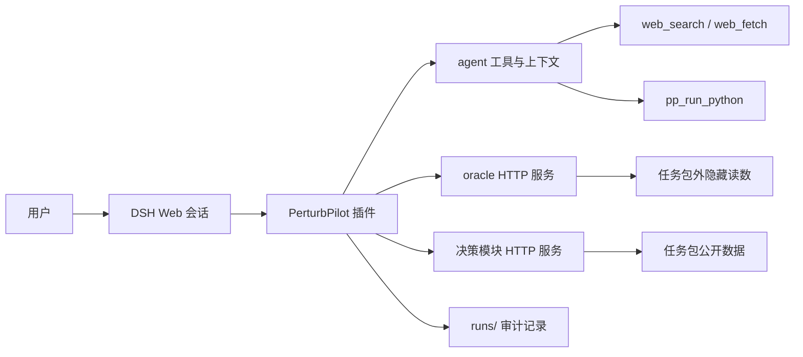

# PerturbPilot

PerturbPilot 是一个基于 [DeepSeek Harness（DSH）](https://github.com/deepseek-ai/deepseek-harness) 的科学发现插件，用于把“提出假设 → 选择候选 → 获取 oracle 读数 → 更新决策 → 继续实验”的闭环接入一个可审计的 agent 会话。

当前仓库已经完成 **v0.1**：18 个真实任务包完成正式闭环验证，具备文献检索、Python 分析、oracle/决策模块回灌、运行记录、失败恢复、请求级幂等、检索生命周期和面向人的执行进度展示。

## 能做什么

- 从任务包读取扰动类型、候选、公开数据、读数字段、目标和预算。
- 由用户在 DSH 面板确认任务、决策方法、轮数和每轮候选数。
- 每轮先取得决策模块推荐，再由 agent 选择候选并按依据分组说明理由。
- 通过 oracle 获取隐藏读数，并将回执交给决策模块更新状态。
- 使用 DSH 的 `web_search` / `web_fetch` 查文献，同时记录完整检索生命周期。
- 使用 `pp_run_python` 做可复现的本地分析；分析环境包含 `numpy`、`pandas`、`scipy`、`scikit-learn` 和 `statsmodels`。
- 在运行目录中保存事件、模型调用、检索、分析、oracle 结果、决策快照和审计结果。
- 在服务响应丢失或服务进程重启后，使用稳定 `request_id` 恢复同一请求，不重复测量或推进决策版本。
- 在 DSH 对话区默认展开工作步骤，并在 PerturbPilot 右侧面板显示当前阶段、轮次进度和最近事件。

## 架构



仓库中的主要部分：

| 路径 | 作用 |
|---|---|
| `plugin/` | DSH 插件、浏览器面板、工具注册、运行状态和审计逻辑 |
| `services/ppsvc/` | Python oracle、决策模块和标准库 HTTP 服务 |
| `services/tests/` | oracle、决策模块、HTTP、幂等和真实进程重启测试 |
| `plugin/test/` | 插件、面板、工具卡片、运行恢复和失败注入测试 |
| `CHANGELOG.md` | 面向人的版本更新日志 |
| `V0.1-CLOSEOUT.md` | v0.1 的验证证据、限制和收口记录 |
| `plugin/README.md` | DSH 插件的详细接口、任务包和运行记录说明 |

## 快速启动

下面的命令适用于 Windows PowerShell。当前 v0.1 使用仓库内的 DSH `0.1.7-rc.1`，并要求使用本机可运行该版本的 Node 22.23：

```powershell
$repo = 'D:\internwork\科学发现智能体系统'
$node = 'D:\DeepSeek\npm-global\node.exe'
$dsh = "$repo\plugin\node_modules\@deepseek-ai\dsh\lib\bin.js"
$python = "$repo\.venv\Scripts\python.exe"
```

先生成任务包并启动 oracle / 决策模块：

```powershell
cd "$repo\services"
& $python -m ppsvc.register_real

# 令牌只放在环境变量，不要写进仓库或运行记录
$env:PERTURBPILOT_SERVICE_TOKEN = '<随机令牌>'
& $python -m ppsvc `
  --tasks "$repo\real-tasks" `
  --hidden-root "$repo\real-tasks-hidden"
```

准备 DSH profile 并启动 Web：

```powershell
$env:DEEPSEEK_API_KEY = (Get-Content '<密钥文件>' -Raw).Trim()
$env:DSH_HOME = 'D:\DeepSeek\pp-home'
Copy-Item "$repo\plugin\web-access.profile.json" "$env:DSH_HOME\web-access.json" -Force

cd "$repo"
& $node $dsh plugin --profile perturbpilot version-exemptions
& $node "$repo\plugin\scripts\link-profile.js" perturbpilot
& $node $dsh --profile perturbpilot --dump-config
& $node $dsh --profile perturbpilot
```

启动后，在浏览器打开 DSH 打印的地址。右侧栏的 **PerturbPilot 任务** 页面可以直接选择任务并开始；也可以在对话里描述想发现的问题，让 agent 提议任务设置，用户在面板确认后开始。

详细启动说明、配置键和服务协议见 [`plugin/README.md`](plugin/README.md)。

## 任务包

任务包和隐藏读数必须分开：agent 可以读取任务包中的公开文件，oracle 才能读取任务包外的隐藏数据。

```text
<task>/
  task.json
  candidates.csv
  data/

<hidden-task>/
  scores.csv
```

`task.json` 至少描述：

- `task_id`、`title`、`synthetic`
- `action`
- `readout.fields`
- `objective`
- `budget`
- `data_cards`

多个任务包可以放在同一个目录下，通过 `--tasks` 和 `--hidden-root` 启动。服务同一时间只允许一个任务处于运行中。

## 运行记录和审计

每个 DSH 会话的记录写入：

```text
runs/<session id>/
  state.json
  events.jsonl
  llm_calls.jsonl
  retrieval/
  analysis/
  oracle/
  decision/
  audit.json
```

其中：

- `events.jsonl` 保存任务、轮次、分析、检索、选择、oracle、决策和控制事件。
- `retrieval/` 保存 `web_search` / `web_fetch` 的参数、正文和生命周期状态。
- `analysis/` 保存分析脚本、输入快照、输出和错误。
- `oracle/` 和 `decision/` 保存服务原始往返与决策快照。
- `audit.json` 检查推荐、选择、文献依据、oracle 读数、决策回执、状态衔接和后续引用是否对应。

检索事件包括：

```text
retrieval/started
retrieval/searched
retrieval/fetched
retrieval/aborted
```

文献审计只把成功完成、没有错误的检索作为证据。候选 ID 别名映射尚未自动放宽，检索正文没有原样出现候选 ID 时会保留为审计失败，避免把证据不足伪装成通过。

## 可靠性和恢复

oracle `/run` 和决策模块 `/observe` 使用稳定请求 ID：

```text
<run_id>:run:<round>
<run_id>:observe:<round>
```

服务端持久化请求指纹、原响应和恢复状态：

- 相同 `request_id` 和相同请求体：返回原响应。
- 相同 `request_id` 和不同请求体：返回 HTTP 409。
- 服务重启后：可以从 journal 恢复重复请求。
- oracle 不会因为响应丢失重复增加 replicate。
- 决策模块不会因为响应丢失重复推进 state version。

## v0.1 验证结果

v0.1 的正式运行和自动化测试结果：

- 18 个真实任务包完成 180 轮。
- Python 分析调用 524 次，其中 442 次成功。
- DSH 原生 trace 中审计到 57 个真实工具错误，并完成框架层分类与恢复修正。
- Node 测试：60 passed。
- Python 测试：37 passed。
- `git diff --check`：passed。

完整证据见 [`V0.1-CLOSEOUT.md`](V0.1-CLOSEOUT.md)，变更历史见 [`CHANGELOG.md`](CHANGELOG.md)。

## 当前版本边界

v0.1 关注单会话单任务闭环、记录和审计。以下能力属于后续版本方向：

- 候选别名和文献证据映射；
- retrieval 证据片段的更细粒度结构化；
- 经验库、仲裁学习和回放分叉；
- 更细粒度的 trace 导出和训练数据转换。

PerturbPilot 依赖 DSH 作为会话、上下文、Web 服务和浏览器运行时，不试图重新实现 DSH 已经提供的能力。

## 许可证与状态

当前仓库处于 v0.1 内部验证完成后的公开整理阶段。依赖版本、启动方式和运行记录格式以仓库中的配置和文档为准。
